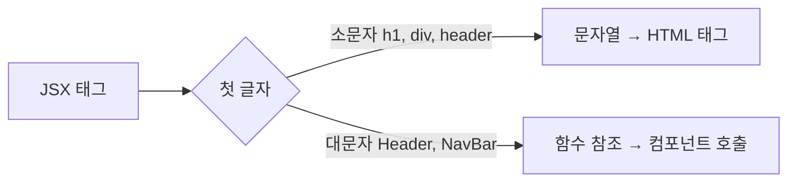
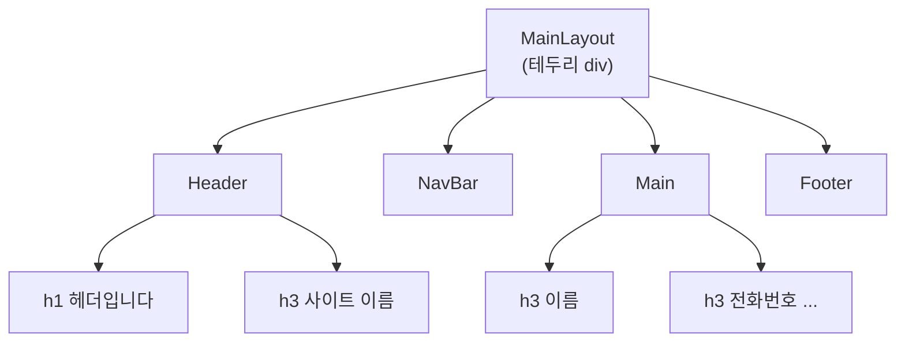

## 들어가며 (Situation)

[JSX 글]({{ site.baseurl }})에서 엘리먼트를 HTML처럼 쓰는 법을 정리했습니다. 이번 실습(`02_component/02_component`)은 JSX로 **컴포넌트를 만들고**, 여러 컴포넌트를 **조합해서** 하나의 화면(레이아웃)을 구성했습니다.

> 실제 서비스에서 겪은 문제가 아니라, 수업 실습을 정리한 글입니다. 설명은 React 공식 문서를 기준으로 했고, 수업 코드 외에 직접 작성한 코드는 "예시 코드"로 표시했습니다. 예제의 이름·전화번호는 가상의 값으로 바꿨습니다.

## 문제 상황 (Task)

웹 페이지는 대부분 헤더, 내비게이션, 본문, 푸터로 이루어집니다. 이걸 엘리먼트 하나에 전부 쓰면,

- 화면 코드 한 덩어리가 수백 줄이 됩니다.
- 헤더를 다른 페이지에서도 쓰고 싶으면 복사해야 합니다.
- 푸터의 문구 하나를 바꾸려면 모든 페이지를 찾아다녀야 합니다.

[Thymeleaf fragment 글]({{ site.baseurl }})에서 서버 템플릿으로 같은 문제를 풀었던 것처럼, React는 **컴포넌트**로 풉니다.

## 해결 과정 (Action)

### 1. 함수형 컴포넌트 만들기

```jsx
// 함수형 컴포넌트의 특징
// 1. 앞글자 대문자!
// 2. return 엘리먼트!
function Header() {
    return (
        <>
            <h1>헤더입니다!!</h1>
            <h3>사이트 이름~~~</h3>
        </>
    );
}

ReactDOM.createRoot(document.getElementById('root'))
    // .render(React.createElement(Header));
    .render(<Header/>);
```

수업에서 정리한 함수형 컴포넌트의 규칙은 두 가지입니다.

| 규칙 | 내용 | 어기면 |
|------|------|-------|
| 이름은 **대문자**로 시작 | `Header`, `NavBar`, `MainLayout` | 소문자(`<header/>`)는 HTML 태그로 해석됨 |
| **엘리먼트를 반환** | JSX(최상위 하나) 또는 `null` | 반환이 없으면(`undefined`) 아무것도 그려지지 않음 |

`Header`는 `h1`, `h3` 두 요소를 반환해야 해서 [Fragment]({{ site.baseurl }})로 묶었습니다.

### 2. 컴포넌트를 JSX 태그로 사용하기

[앞 글]({{ site.baseurl }})에서는 `React.createElement(Header)`로 컴포넌트를 엘리먼트로 만들었습니다. JSX에서는 컴포넌트 이름을 **태그처럼** 씁니다.

```jsx
<Header/>                       // 자식이 없으면 스스로 닫기
<Header></Header>               // 같은 의미
// React.createElement(Header) 와 같음
```

**왜 대문자여야 할까?**

수업 주석은 "컴포넌트의 앞글자가 소문자면 컴포넌트로 인식하는 것이 아닌 단순 html 요소로 인식하게 된다"고 설명합니다. JSX를 변환할 때 Babel은 태그 이름의 첫 글자를 보고 둘 중 하나로 바꿉니다.

```javascript
// 예시 코드 — JSX 가 변환되는 모습
<header/>   →  React.createElement('header')   // 문자열 : HTML <header> 태그
<Header/>   →  React.createElement(Header)     // 변수 : 우리가 만든 함수
```

소문자 `header`는 **문자열**이 되어 HTML 태그를 만들고, 대문자 `Header`는 **변수(함수) 참조**가 됩니다. 만약 컴포넌트를 `function header()`처럼 소문자로 만들면, `<header/>`는 우리 함수를 무시하고 HTML의 `<header>` 태그를 그립니다. 오류도 나지 않아서 원인을 찾기 어렵습니다. 그래서 대문자 규칙은 관례가 아니라 **반드시 지켜야 하는 규칙**입니다.



### 3. 컴포넌트 조합: 작은 조각으로 큰 화면 만들기

```jsx
function Header() {
    return (
        <>
            <h1>헤더입니다!!</h1>
            <h3>사이트 이름~~~</h3>
        </>
    );
}

function NavBar() {
    return (
        <>
            <h3>네비게이션 바 입니다!!</h3>
        </>
    );
}

function Footer() {
    return (
        <>
            <h3>푸터 입니다!!!</h3>
        </>
    );
}

const user = {
    name : "홍길동",
    phone : "010-0000-0000",
    age : 20,
    gender : '남'
};

function Main() {
    return (
        <>
            <h3>이름 : {user.name}</h3>
            <h3>전화번호 : {user.phone}</h3>
            <h3>나이 : {user.age}</h3>
            <h3>성별 : {user.gender}</h3>
        </>
    );
}

function MainLayout() {
    return (
        <div style={{border : '1px solid black', backgroundColor : 'red'}}>
            <Header/>
            <NavBar/>
            <Main/>
            <Footer/>
        </div>
    );
}

ReactDOM.createRoot(document.getElementById('root')).render(<MainLayout/>);
```

`MainLayout`은 직접 `h1`이나 `h3`를 만들지 않고, 다른 컴포넌트들을 **태그처럼 배치**만 합니다. 이렇게 작은 컴포넌트를 큰 컴포넌트 안에 넣어 화면을 만드는 것을 **조합(composition)**이라고 합니다.



화면에 실제로 그려지는 HTML은 이렇습니다.

```html
<div id="root">
    <div style="border: 1px solid black; background-color: red;">
        <h1>헤더입니다!!</h1>
        <h3>사이트 이름~~~</h3>
        <h3>네비게이션 바 입니다!!</h3>
        <h3>이름 : 홍길동</h3>
        <h3>전화번호 : 010-0000-0000</h3>
        <h3>나이 : 20</h3>
        <h3>성별 : 남</h3>
        <h3>푸터 입니다!!!</h3>
    </div>
</div>
```

컴포넌트 이름(`Header`, `Main`)은 실제 DOM에 남지 않습니다. 컴포넌트는 엘리먼트를 만드는 함수일 뿐이고, 각 컴포넌트가 Fragment로 반환했기 때문에 감싸는 요소도 생기지 않았습니다. 바깥 테두리 `div`는 `MainLayout`이 실제로 박스가 필요해서 만든 것입니다. 이것이 [JSX 글]({{ site.baseurl }})에서 정리한 "박스가 필요하면 div, 묶기만 하면 Fragment"의 실제 예입니다.

`style` 속성은 객체로 넘기고, CSS의 `background-color`는 `backgroundColor`로 씁니다.

### 4. 조합의 장점

| 문제 | 한 덩어리 화면 | 컴포넌트 조합 |
|------|--------------|--------------|
| 코드 읽기 | 수백 줄의 태그 | `<Header/> <NavBar/> <Main/> <Footer/>`만 보면 구조 파악 |
| 재사용 | 복사·붙여넣기 | 다른 레이아웃에서도 `<Header/>`로 사용 |
| 수정 | 모든 페이지 수정 | `Footer` 함수 하나만 수정 |
| 역할 분리 | 섞여 있음 | 헤더는 헤더만, 본문은 본문만 책임 |

Java로 생각하면 [MVC 계층 분리]({{ site.baseurl }})처럼 **하나의 클래스(컴포넌트)는 하나의 책임**을 지게 나누는 것과 같은 원리입니다. 거대한 `main` 메서드 하나 대신 역할별 메서드와 클래스로 나눴던 것처럼, 거대한 화면 하나 대신 역할별 컴포넌트로 나눕니다.

### 5. Thymeleaf fragment와 비교

서버 렌더링에서도 같은 문제를 같은 발상으로 풀었습니다.

```html
<!-- 예시 — Thymeleaf fragment (서버) -->
<header th:replace="~{common/header :: headerFragment}"></header>
<main> ... </main>
<footer th:replace="~{common/footer :: footerFragment}"></footer>
```

```jsx
// React 컴포넌트 (브라우저)
<Header/>
<Main/>
<Footer/>
```

| 비교 | Thymeleaf fragment | React 컴포넌트 |
|------|-------------------|---------------|
| 조각의 정체 | HTML 파일 안의 `th:fragment` 영역 | 엘리먼트를 반환하는 JS 함수 |
| 끼워 넣는 방법 | `th:replace` / `th:insert` | `<컴포넌트/>` |
| 조합되는 곳 | **서버** (Java, 응답 전) | **브라우저** (JS, 페이지 로드 후) |
| 매개변수 | `~{common/aside :: asideFragment('a', 'b')}` | props (다음 단계) |
| 데이터가 바뀌면 | 새 요청 → 서버가 페이지 전체 다시 생성 | 해당 컴포넌트만 다시 그림 |

### 6. 지금 구조의 한계: 데이터가 컴포넌트에 묶여 있다

`Main` 컴포넌트는 바깥의 `user` 객체를 **직접** 읽습니다. 그래서 다른 사람의 정보를 보여 주는 `Main`이 필요하면 `user` 객체를 바꾸거나 컴포넌트를 하나 더 만들어야 합니다. 같은 모양의 카드를 데이터만 바꿔 여러 번 쓰기 어렵습니다.

```jsx
// 예시 코드 — 앞으로 배울 props 방식 미리 보기
function Main({ user }) {                 // 부모가 넘긴 값을 매개변수로 받음
    return <h3>이름 : {user.name}</h3>;
}

<Main user={kim}/>
<Main user={lee}/>
```

컴포넌트에 값을 **매개변수처럼** 넘기는 방법이 **props**입니다. Thymeleaf의 매개변수가 있는 fragment와 같은 역할이고, Java 메서드가 매개변수를 받아 다른 결과를 내는 것과 같습니다. 함수의 매개변수 자리에서 `{ user }`로 꺼내는 문법은 [구조 분해 할당]({{ site.baseurl }})입니다.

## 결과 (Result)

정량 지표는 없고, 아래를 정리했습니다.

- 함수형 컴포넌트는 이름이 대문자로 시작하고 엘리먼트를 반환하는 함수이며, JSX에서 `<Header/>`처럼 태그로 씁니다.
- 대문자 규칙은 동작 규칙입니다. JSX 변환 시 소문자 태그는 문자열(HTML 태그), 대문자 태그는 함수 참조(컴포넌트)가 되므로, 소문자 컴포넌트는 오류 없이 무시됩니다.
- 작은 컴포넌트를 큰 컴포넌트 안에 배치하는 조합으로 화면을 만들고, 컴포넌트 이름은 실제 DOM에 남지 않습니다.
- 조합은 읽기, 재사용, 수정, 역할 분리를 쉽게 만들며, Thymeleaf fragment와 같은 발상을 브라우저에서 실행하는 것입니다.
- 컴포넌트가 바깥 데이터를 직접 읽으면 재사용이 어렵고, props로 데이터를 넘기는 구조가 다음 단계입니다.

## 더 학습하면 좋은 개념

- **Props** — 부모가 자식 컴포넌트에 값을 넘기는 방법과, props는 읽기 전용이라는 규칙입니다.
- **`children` prop** — `<Layout>...</Layout>`처럼 태그 사이에 넣은 내용을 받는 방법으로, 레이아웃 컴포넌트를 만들 때 핵심입니다.
- **컴포넌트를 순수 함수로 유지하기** — 같은 입력이면 같은 JSX를 반환해야 한다는 React의 원칙입니다.
- **컴포넌트 분리 기준** — 어디까지 쪼갤지 정하는 기준(단일 책임, 재사용 여부)입니다.
- **컴포넌트 트리와 데이터 흐름** — 데이터가 부모에서 자식으로 한 방향으로 흐르는 React의 구조입니다.

## 참고 자료

- [React - Your First Component](https://react.dev/learn/your-first-component)
- [React - Importing and Exporting Components](https://react.dev/learn/importing-and-exporting-components)
- [React - Passing Props to a Component](https://react.dev/learn/passing-props-to-a-component)
- [React - Keeping Components Pure](https://react.dev/learn/keeping-components-pure)
- [React - Understanding Your UI as a Tree](https://react.dev/learn/understanding-your-ui-as-a-tree)
- [React - Thinking in React](https://react.dev/learn/thinking-in-react)
