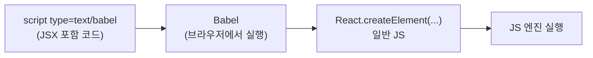
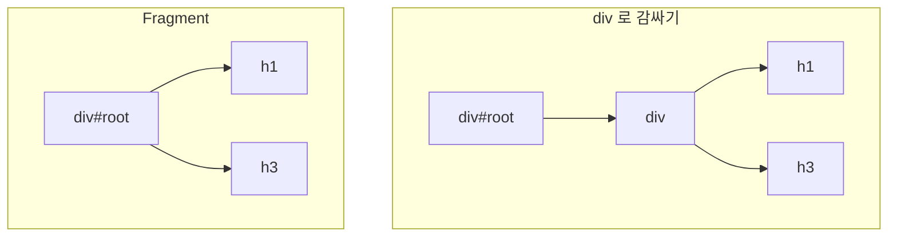

## 들어가며 (Situation)

[앞 글]({{ site.baseurl }})에서 `React.createElement`로 엘리먼트를 만들었습니다. 자식이 두세 개만 돼도 괄호가 깊어져 읽기 어려웠습니다. 수업 주석도 "요소를 만들 때마다 createElement로 만들면 굉장히 복잡하고 힘들다"고 했습니다. 이번 실습(`02_component/01_JSX`)은 그 대안인 **JSX**와, JSX를 쓸 때 가장 먼저 만나는 규칙인 **최상위 요소 하나**와 **Fragment**를 다룹니다.

> 실제 서비스에서 겪은 문제가 아니라, 수업 실습을 정리한 글입니다. 설명은 React 공식 문서와 Babel 문서를 기준으로 했고, 수업 코드 외에 직접 작성한 코드는 "예시 코드"로 표시했습니다. 예제의 이름·전화번호는 가상의 값으로 바꿨습니다.

## 문제 상황 (Task)

```javascript
// 예시 코드 — createElement 만으로 만든 메뉴 카드
React.createElement('div', { className: 'card' },
    React.createElement('h2', null, menu.name),
    React.createElement('p', null, '가격 : ', menu.price, '원'),
    React.createElement('button', { onClick: order }, '주문')
);
```

- 결과 HTML 구조가 한눈에 보이지 않습니다.
- HTML을 쓰듯 화면을 쓸 수는 없을까요?
- 그렇게 쓰면 브라우저는 그 문법을 어떻게 이해할까요?

## 해결 과정 (Action)

### 1. JSX: JavaScript 안에 쓰는 HTML 모양 문법

```jsx
const element = <h1 className="test">안녕!!</h1>;
```

JSX(JavaScript XML)는 JavaScript 코드 안에서 **HTML처럼 생긴 문법으로 엘리먼트를 표현**하는 확장 문법입니다. 위 코드는 아래와 **완전히 같은 의미**입니다.

```javascript
const element = React.createElement('h1', { className: "test" }, "안녕!!");
```

앞의 메뉴 카드도 JSX로 쓰면 결과 HTML과 거의 같은 모양이 됩니다.

```jsx
// 예시 코드
<div className="card">
    <h2>{menu.name}</h2>
    <p>가격 : {menu.price}원</p>
    <button onClick={order}>주문</button>
</div>
```

JSX는 새로운 기능이 아니라 **`createElement` 호출을 편하게 쓰는 표기법**입니다. 그래서 JSX 하나는 엘리먼트 하나(객체 하나)이고, 변수에 담거나 함수에서 반환할 수 있습니다.

### 2. JSX는 변환이 필요하다: Babel

브라우저의 JavaScript 엔진은 JSX를 모릅니다. `<h1>`을 만나면 문법 오류를 냅니다. 그래서 **변환기**가 JSX를 `React.createElement(...)` 같은 일반 JavaScript로 바꿔 줘야 합니다. 대표적인 변환기가 **Babel**입니다.

수업 주석에 정리된 사용법은 두 단계입니다.

```html
<!-- 1. 바벨 관련 script 를 head 영역에 추가 -->
<script src=".../babel.min.js"></script>

<!-- 2. script 태그의 type 속성에 text/babel 값 추가 -->
<script type="text/babel">
    const element = <h1>안녕!!</h1>;
    ReactDOM.createRoot(document.getElementById('root')).render(element);
</script>
```



브라우저는 `type="text/babel"`인 스크립트를 JavaScript로 실행하지 않고 그냥 둡니다. Babel이 이 스크립트를 찾아 변환한 뒤 실행합니다. 이 방식은 페이지를 열 때마다 변환하므로 느려서 **학습용**입니다. 실제 프로젝트는 [Vite 글]({{ site.baseurl }})처럼 빌드 도구가 **미리** 변환해 둡니다.

### 3. 중괄호 `{ }`: JSX 안에 JavaScript 넣기

```jsx
function formatName(user) {
    return `${user.lastName} ${user.firstName}`;
}

const user = {
    firstName : '길동',
    lastName : '홍'
};

// jsx 내에서 중괄호를 활용하여 모든 js 표현식을 사용할 수 있다.
const element = <h1 className="test">안녕!! {formatName(user)}</h1>;
// 화면 : 안녕!! 홍 길동
```

JSX 안의 `{ }`는 "여기부터는 JavaScript"라는 표시입니다. 들어갈 수 있는 것은 **표현식**(값이 되는 코드)입니다.

| `{ }` 안에 | 가능 여부 | 예 |
|-----------|----------|-----|
| 변수, 프로퍼티 | O | `{user.name}` |
| 함수 호출 | O | `{formatName(user)}` |
| 계산식 | O | `{price * 0.9}` |
| 삼항 연산자 | O | `{isSoldOut ? '품절' : '판매중'}` |
| 템플릿 리터럴 | O | `` {`${n}개`} `` |
| 배열의 `map` | O | `{menus.map(m => <li>{m}</li>)}` |
| `if`, `for` 문 | **X** (문장이라 값이 아님) | 대신 삼항 연산자, `&&`, `map` 사용 |

[템플릿 리터럴]({{ site.baseurl }})의 `${ }`, [Thymeleaf]({{ site.baseurl }})의 `th:text="${...}"`와 같은 역할입니다. 차이는 Thymeleaf가 `th:if`, `th:each`라는 별도 문법으로 조건·반복을 처리했다면, JSX는 **JavaScript 문법(삼항, `&&`, `map`)을 그대로** 쓴다는 점입니다.

`{ }` 안의 값에 따라 화면에 나오는 것도 다릅니다.

| 값 | 화면 |
|----|------|
| 문자열, 숫자 | 그대로 출력 |
| `true`, `false`, `null`, `undefined` | **아무것도 출력하지 않음** |
| 엘리먼트, 엘리먼트 배열 | 그 엘리먼트들을 그림 |
| 일반 객체 (`{user}`) | **오류** (객체는 그대로 그릴 수 없음) |

`false`가 출력되지 않는 성질을 이용해 `{isLoggedIn && <Logout/>}`처럼 조건부로 그리는 패턴을 많이 씁니다. 그리고 `{user}`처럼 객체를 통째로 넣으면 "Objects are not valid as a React child" 오류가 나므로 `{user.name}`처럼 값을 꺼내야 합니다.

`{ }` 안의 문자열은 **자동으로 이스케이프**됩니다. 사용자 입력에 `<script>`가 들어 있어도 태그로 해석되지 않고 글자로 표시됩니다. Thymeleaf의 `th:text`가 기본으로 이스케이프했던 것과 같은 XSS 방어입니다.

### 4. JSX 속성: HTML과 다른 점

수업 코드는 `<h1 class="test">`로 썼습니다. 화면은 나오지만, 개발 모드 콘솔에는 `class` 대신 `className`을 쓰라는 경고가 뜹니다. JSX의 속성은 결국 `createElement`의 **props 객체 key**가 되고, React는 props 이름으로 HTML 속성 이름이 아니라 **DOM 프로퍼티 이름(카멜 표기)**을 씁니다. 게다가 `class`는 JavaScript 예약어입니다.

| HTML | JSX | 이유 |
|------|-----|------|
| `class="test"` | `className="test"` | `class`는 JS 예약어, DOM 프로퍼티 이름은 `className` |
| `<label for="id">` | `<label htmlFor="id">` | `for`는 JS 예약어 |
| `onclick="..."` | `onClick={함수}` | 카멜 표기, 코드 문자열이 아니라 **함수 참조** |
| `tabindex` | `tabIndex` | 카멜 표기 |
| `style="color: red; font-size: 20px"` | `style={{color: 'red', fontSize: '20px'}}` | 문자열이 아니라 **객체** |
| `<br>`, `` | `<br />`, `` | 모든 태그는 반드시 닫아야 함 |
| `<!-- 주석 -->` | `{/* 주석 */}` | JSX 안 주석은 JS 주석을 `{ }`로 감쌈 |

`onClick={함수}`는 [이벤트 글]({{ site.baseurl }})의 정리와 연결됩니다. HTML 어트리뷰트 방식은 **호출문 문자열**(`onclick="order()"`)을 넣었지만, JSX는 프로퍼티 방식처럼 **함수 참조**(`onClick={order}`)를 넘깁니다. `onClick={order()}`라고 쓰면 화면을 그리는 순간 함수가 실행되어 버립니다.

`style={{ }}`의 중괄호가 두 겹인 이유는, 바깥 `{ }`가 "JavaScript 표현식 시작", 안쪽 `{ }`가 **객체 리터럴**이기 때문입니다. CSS 속성은 [DOM 글]({{ site.baseurl }})의 `element.style.backgroundColor`처럼 카멜 표기(`backgroundColor`, `fontSize`)를 씁니다.

### 5. 규칙: 최상위 요소는 하나

```jsx
const user = {
    name : '길동',
    phone : '010-0000-0000'
}

// 1. 최상위 엘리먼트가 두 개 이상 (== 같은 레벨) 이면 문법 에러
// const element = (
//     <h1>{user.name}</h1>
//     <h3>{user.phone}</h3>
// );
```

같은 레벨의 요소 두 개를 감싸는 것 없이 나란히 쓰면 **문법 오류**가 납니다. JSX를 `createElement`로 바꿔 보면 이유가 보입니다.

```javascript
// 예시 코드 — 위 JSX 를 그대로 바꾸면
const element = (
    React.createElement('h1', null, user.name)
    React.createElement('h3', null, user.phone)   // 값 두 개를 이어 쓸 방법이 없음
);
```

JSX 하나는 `createElement` **호출 하나 = 값 하나**입니다. 변수 하나에 값 두 개를 넣을 수 없고, 함수가 `return`으로 값 두 개를 돌려줄 수 없는 것과 같습니다. Java 메서드가 `return a, b;`를 할 수 없는 것과 같은 이유입니다.

여러 줄의 JSX를 `( )`로 감싸는 것은 문법 요구가 아니라, `return` 뒤 줄바꿈 때문에 생기는 문제를 피하고 읽기 좋게 하려는 관례입니다.

### 6. div로 감싸기와 그 단점

```jsx
// 2. 최상위 엘리먼트 내부에 넣어서 하나의 돔트리를 생성
const element = (
    <div>
        <h1>{user.name}</h1>
        <h3>{user.phone}</h3>
    </div>
);
```

`<div>` 하나로 감싸면 값이 하나가 되어 동작합니다. 하지만 실제 화면에 **의미 없는 `<div>`가 하나 더** 생깁니다.

```html
<div id="root">
    <div>             ← 묶으려고 추가했을 뿐인 div
        <h1>길동</h1>
        <h3>010-0000-0000</h3>
    </div>
</div>
```

이 `div`가 문제를 일으키는 경우가 있습니다.

- **레이아웃이 깨짐**: 부모가 `display: flex`로 자식들을 가로로 배치하는데, 중간에 `div`가 끼면 `h1`, `h3`가 아니라 `div` 하나만 flex 아이템이 됩니다. [Flex·Grid 글]({{ site.baseurl }})의 배치가 의도와 달라집니다.
- **HTML 구조가 틀림**: `<ul>` 안에는 `<li>`만, `<tr>` 안에는 `<td>`만 와야 하는데 `div`가 끼면 올바르지 않은 HTML이 됩니다. 표의 행을 컴포넌트로 만들 때 자주 만나는 문제입니다.
- 컴포넌트를 많이 조합할수록 `div`가 겹겹이 쌓여 구조가 복잡해집니다.

### 7. Fragment: 묶기만 하고 흔적은 남기지 않는다

```jsx
// 3. <></> (React.Fragment)
const element = (
    <>
        <h1>{user.name}</h1>
        <h3>{user.phone}</h3>
    </>
);
```

```html
<div id="root">
    <h1>길동</h1>
    <h3>010-0000-0000</h3>
</div>
```

`<></>`는 **Fragment**입니다. JSX 규칙상 하나로 묶어 주지만, 실제 DOM에는 아무 요소도 만들지 않습니다.

| 방식 | JSX 규칙 | 실제 DOM | 쓰는 경우 |
|------|---------|---------|----------|
| 나란히 쓰기 | 위반 (오류) | — | — |
| `<div>`로 감싸기 | 통과 | `div` 추가됨 | 감싸는 박스가 실제로 필요할 때 (테두리, 배경 등) |
| `<>...</>` | 통과 | **추가 없음** | 묶기만 필요할 때 |
| `<React.Fragment key={...}>` | 통과 | 추가 없음 | 목록에서 `key`를 줘야 할 때 |

`<></>`는 `<React.Fragment></React.Fragment>`의 축약형입니다. 축약형에는 속성을 쓸 수 없어서, `map`으로 Fragment 목록을 만들며 `key`를 줘야 할 때만 긴 형태를 씁니다.



## 결과 (Result)

정량 지표는 없고, 아래를 정리했습니다.

- JSX는 `React.createElement` 호출을 HTML 모양으로 쓰는 문법이고, JSX 하나는 엘리먼트(값) 하나입니다.
- 브라우저는 JSX를 모르므로 Babel 같은 변환기가 필요합니다. `<script type="text/babel">`은 학습용이고 실제 프로젝트는 빌드 도구가 미리 변환합니다.
- `{ }` 안에는 값이 되는 표현식만 쓸 수 있습니다(`if`/`for` 대신 삼항, `&&`, `map`). `true`/`false`/`null`/`undefined`는 출력되지 않고, 객체는 그대로 넣으면 오류이며, 문자열은 자동 이스케이프됩니다.
- 속성은 `className`, `htmlFor`, `onClick={함수}`, `style={{객체}}`처럼 DOM 프로퍼티 이름·카멜 표기를 쓰고, 모든 태그는 닫습니다.
- 최상위 요소는 하나여야 합니다. `div`로 감싸면 불필요한 요소가 생겨 레이아웃·HTML 구조를 해칠 수 있으므로, 묶기만 필요하면 Fragment(`<></>`)를 씁니다.

## 더 학습하면 좋은 개념

- **조건부 렌더링** — 삼항 연산자, `&&`, 함수 안의 `if`로 화면의 일부를 보이거나 숨기는 방법과, `0 && ...`이 `0`을 출력하는 함정입니다.
- **리스트 렌더링과 `key`** — `map`으로 배열을 엘리먼트 목록으로 만드는 방법과 `key`가 필요한 이유입니다.
- **JSX Transform** — React 17부터 JSX가 `React.createElement` 대신 `react/jsx-runtime`의 함수로 바뀌어, 파일마다 `import React`를 쓰지 않아도 되게 된 변화입니다.
- **`dangerouslySetInnerHTML`** — 이스케이프를 끄고 HTML을 그대로 넣는 방법으로, 이름처럼 XSS 위험이 있습니다. Thymeleaf의 `th:utext`에 해당합니다.
- **TSX** — JSX에 TypeScript 타입을 더한 문법으로, props의 타입을 컴파일 단계에서 검사합니다.

## 참고 자료

- [React - Writing Markup with JSX](https://react.dev/learn/writing-markup-with-jsx)
- [React - JavaScript in JSX with Curly Braces](https://react.dev/learn/javascript-in-jsx-with-curly-braces)
- [React - Conditional Rendering](https://react.dev/learn/conditional-rendering)
- [React - Fragment](https://react.dev/reference/react/Fragment)
- [React - Common components (className, htmlFor, style)](https://react.dev/reference/react-dom/components/common)
- [Babel - @babel/standalone](https://babeljs.io/docs/babel-standalone)
- [React Blog - Introducing the New JSX Transform](https://legacy.reactjs.org/blog/2020/09/22/introducing-the-new-jsx-transform.html)
