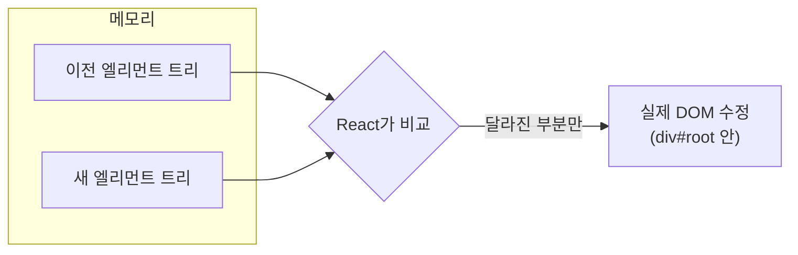
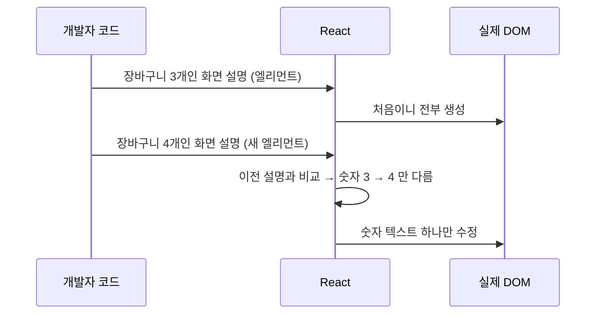
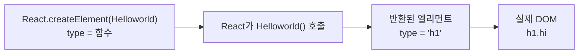

## 들어가며 (Situation)

JavaScript 기초(문법, [DOM]({{ site.baseurl }}), [이벤트]({{ site.baseurl }}), [비동기]({{ site.baseurl }}))를 마치고 React 수업(`12_React`)이 시작됐습니다. React 첫 글은 빌드 도구 없이 HTML 파일 하나에 React를 불러와, React가 화면을 만드는 가장 기본 단위인 **엘리먼트**와 **컴포넌트**를 확인한 실습(`01_intro`)입니다.

React 시리즈는 다음 순서로 정리합니다.

1. 가상 DOM, createElement, 엘리먼트와 컴포넌트 (이 글)
2. [JSX 문법과 Fragment]({{ site.baseurl }})
3. [함수형 컴포넌트와 조합]({{ site.baseurl }})
4. [Vite 프로젝트와 모듈 import/export]({{ site.baseurl }})
5. [CSS Module과 React Router]({{ site.baseurl }})

> 실제 서비스에서 겪은 문제가 아니라, 수업 실습을 정리한 글입니다. 설명은 React 공식 문서(react.dev)를 기준으로 했고, 수업 코드 외에 직접 작성한 코드는 "예시 코드"로 표시했습니다.

## 문제 상황 (Task)

지금까지 화면을 바꾸는 방법은 "요소를 찾아서 직접 고치기"였습니다.

```javascript
// 예시 코드 — 지금까지의 방식
const $msg = document.querySelector('.message');
$msg.textContent = `배달 위치 : ${x}, ${y}`;
$msg.classList.add('active');
```

화면이 작을 때는 문제가 없습니다. 하지만 장바구니 개수, 로그인 상태, 메뉴 목록처럼 바뀌는 데이터가 많아지면,

- 데이터 하나가 바뀔 때 **화면의 어느 요소들을 어떻게 고쳐야 하는지** 개발자가 전부 기억하고 코드로 써야 합니다. 하나라도 빠뜨리면 화면과 데이터가 어긋납니다.
- 같은 모양의 화면 조각(메뉴 카드, 헤더)을 여러 곳에서 쓰려면 HTML을 복사하거나 `createElement`로 일일이 조립해야 합니다.

React는 이 두 문제에 대해 다른 접근을 제안합니다. **"어떻게 고칠지" 대신 "무엇이 보여야 하는지"를 선언**하고, 화면을 **컴포넌트** 단위로 나눕니다.

## 해결 과정 (Action)

### 1. React를 HTML에 불러오기

첫 실습은 빌드 도구 없이 `<script>` 태그로 React를 불러왔습니다. React는 두 개의 라이브러리로 나뉩니다.

| 라이브러리 | 역할 |
|-----------|------|
| `react` | 엘리먼트와 컴포넌트를 만드는 핵심 (`React.createElement` 등) |
| `react-dom` | 만든 것을 **브라우저 DOM**에 그리는 역할 (`ReactDOM.createRoot`) |

React의 핵심과 "어디에 그릴지"가 분리되어 있어서, 같은 `react`로 브라우저 대신 모바일 앱(React Native)에 그리는 것도 가능합니다.

HTML에는 React가 화면을 그릴 빈 자리 하나만 둡니다.

```html
<div id="root"></div>
```

이 `div#root` 안의 내용은 이제 React가 관리합니다. 직접 `querySelector`로 손대지 않습니다.

### 2. React.createElement: 엘리먼트 만들기

```javascript
/*
    1번째 인자 : 만들려는 요소의 타입 (ex) h1, div, pre)
    2번째 인자 : 요소의 프로퍼티
    3번째 인자 : 자식 요소
*/
const hiElement = React.createElement('h1', {className: 'hi'}, 'helloworld!!');

ReactDOM.createRoot(document.getElementById('root')).render(hiElement);
```

결과로 화면에는 다음 HTML이 그려집니다.

```html
<div id="root">
    <h1 class="hi">helloworld!!</h1>
</div>
```

| 인자 | 의미 | 이 예제 |
|------|------|--------|
| `type` | 요소 종류 (태그 이름 문자열, 또는 컴포넌트 함수) | `'h1'` |
| `props` | 속성 객체. 없으면 `null` | `{className: 'hi'}` → `class="hi"` |
| `...children` | 자식. 문자열, 숫자, 다른 엘리먼트를 여러 개 넣을 수 있음 | `'helloworld!!'` |

HTML의 `class` 속성을 `className`이라고 쓴 점이 눈에 띕니다. props 이름은 HTML 속성 이름이 아니라 **DOM 프로퍼티 이름**을 따르기 때문입니다. [DOM 글]({{ site.baseurl }})에서 `element.className`, `element.style.backgroundColor`처럼 JavaScript에서 쓰던 이름과 같습니다.

**자식을 여러 개, 중첩해서**

```javascript
// 예시 코드
const card = React.createElement(
    'div',
    { className: 'card' },
    React.createElement('h2', null, '떡볶이'),
    React.createElement('p', null, '가격 : ', 4000, '원')
);
```

```html
<div class="card">
    <h2>떡볶이</h2>
    <p>가격 : 4000원</p>
</div>
```

세 번째 인자부터는 몇 개든 자식으로 들어가고, 자식 자리에 다른 `createElement`를 넣으면 중첩됩니다. 이 정도만 돼도 괄호가 깊어져 읽기 어렵습니다. 그래서 [다음 글]({{ site.baseurl }})의 JSX가 등장합니다.

### 3. 엘리먼트는 "화면 설명서" 객체다

`React.createElement`가 반환하는 것은 실제 `<h1>` DOM 요소가 아닙니다. 콘솔에 찍어 보면 평범한 JavaScript 객체입니다.

```javascript
// 예시 코드
console.log(hiElement);
// { type: 'h1', props: { className: 'hi', children: 'helloworld!!' }, key: null, ... }
```

"`type`이 `h1`이고, `className`은 `hi`, 내용은 `helloworld!!`인 요소를 그려 달라"는 **설명서**일 뿐입니다. 실제 DOM 요소보다 훨씬 가볍습니다.

| 비교 | 실제 DOM 요소 | React 엘리먼트 |
|------|-------------|---------------|
| 만드는 법 | `document.createElement('h1')` | `React.createElement('h1', ...)` |
| 정체 | 브라우저가 관리하는 무거운 객체 (수백 개의 속성·메서드) | `type`, `props` 정도만 가진 일반 객체 |
| 화면 반영 | 문서에 붙이는 순간 화면에 나타남 | `render()`를 거쳐야 실제 DOM이 됨 |
| 변경 | 직접 수정 (`textContent = ...`) | 수정하지 않고 **새로 만든다** (불변) |

React 엘리먼트는 한 번 만들면 바꾸지 않습니다. 화면이 달라져야 하면 **새 엘리먼트를 만들어** 다시 그리게 합니다. [스프레드 글]({{ site.baseurl }})에서 "원본을 바꾸지 않고 새 객체를 만드는 방식이 React에서 기본"이라고 했던 이유가 여기서 시작됩니다.

### 4. 가상 DOM: 비교해서 바뀐 부분만 실제 DOM에

수업 주석은 이렇게 설명합니다.

> React는 가상돔(Virtual DOM)이라는 개념을 가지고 있다. 메모리 상에 존재하는 DOM (코드 상으로 구현)

엘리먼트 객체들이 모여 만든 "화면 구조의 설명"이 메모리에 있고, React는 이것을 기준으로 실제 DOM을 만듭니다. 이 메모리 속 구조를 흔히 **가상 DOM**이라고 부릅니다.



데이터가 바뀌면 React는 새 엘리먼트 트리를 만들고 **이전 트리와 비교**해서, 실제로 달라진 부분만 실제 DOM에 반영합니다. React 공식 문서는 이 비교 과정을 **재조정(reconciliation)**이라고 부릅니다.



이 방식의 가장 큰 의미는 성능보다 **개발 방식의 변화**입니다.

| 비교 | 직접 DOM 조작 (명령형) | React (선언형) |
|------|---------------------|---------------|
| 개발자가 쓰는 것 | "이 요소를 찾아서 글자를 바꾸고 class를 붙여라" | "장바구니가 4개일 때 화면은 이렇게 생겼다" |
| 데이터 변경 시 | 영향받는 요소를 모두 찾아 고치는 코드 작성 | 새 데이터로 화면을 다시 설명 |
| 실제 DOM 변경 | 개발자 코드가 직접 | React가 비교 후 필요한 부분만 |
| 실수 지점 | 고칠 요소를 빠뜨리면 화면과 데이터가 어긋남 | 화면은 항상 현재 데이터의 설명과 일치 |

Java 쪽에 비유하면, [Thymeleaf]({{ site.baseurl }})에서 `th:text="${menu.name}"`이라고 **"여기에 메뉴 이름이 들어간다"고 선언**하면 값을 넣는 일은 템플릿 엔진이 했던 것과 비슷합니다. 차이는 Thymeleaf는 서버에서 한 번 HTML을 만들고 끝나지만, React는 브라우저에서 데이터가 바뀔 때마다 이 과정을 반복한다는 점입니다.

### 5. ReactDOM.createRoot와 render

```javascript
ReactDOM.createRoot(document.getElementById('root')).render(hiElement);
```

| 단계 | 하는 일 |
|------|--------|
| `document.getElementById('root')` | React가 그릴 실제 DOM 자리를 찾음 (여기서만 DOM API 사용) |
| `ReactDOM.createRoot(...)` | 그 자리를 React가 관리하는 **루트**로 만듦 |
| `.render(엘리먼트)` | 엘리먼트를 실제 DOM으로 그림. 기존 내용은 React가 관리하는 내용으로 교체 |

`createRoot`는 React 18부터 쓰는 방식입니다. 예전 자료에서 보이는 `ReactDOM.render(element, container)`는 React 19에서 제거되었으므로, 새로 작성하는 코드는 `createRoot`를 씁니다.

### 6. 컴포넌트: 엘리먼트를 반환하는 함수

```javascript
// 함수형 컴포넌트 -> 함수 이름 앞글자 대문자!!
function Helloworld() {
    return React.createElement('h1', {className: 'hi'}, 'helloworld!!');
}

ReactDOM.createRoot(document.getElementById('root'))
    .render(React.createElement(Helloworld));   // 컴포넌트를 엘리먼트로
```

수업에서 정리한 두 개념은 다음과 같습니다.

| 개념 | 설명 | 예 |
|------|------|-----|
| **엘리먼트** | 요소 노드, 어트리뷰트 노드, 텍스트 노드로 구성된 화면 요소 하나의 설명 | `<h1 class='test'>안녕!!</h1>` |
| **컴포넌트** | 엘리먼트를 **반환하는** 함수. 화면을 구성하는 조각 단위 | `function Helloworld() { return ...; }` |

`render()`에는 컴포넌트 함수 자체가 아니라 **엘리먼트**를 넘겨야 합니다. 그래서 `React.createElement(Helloworld)`처럼 컴포넌트를 `type` 자리에 넣어 엘리먼트로 만듭니다. `type`에 `'h1'` 같은 문자열 대신 함수가 들어가면, React는 그 함수를 호출해서 반환된 엘리먼트를 그립니다.



**왜 함수 이름을 대문자로 시작할까?**

수업 주석은 "컴포넌트 함수는 엘리먼트를 반환하는 특별한 함수이므로, 일반 함수와 구분하기 위해 앞글자를 대문자로 쓰는 것을 규칙처럼 활용한다"고 설명합니다. `createElement`만 쓸 때는 관례지만, [다음 글]({{ site.baseurl }})의 JSX에서는 **실제 동작 규칙**이 됩니다. JSX는 `<header/>`처럼 소문자로 시작하면 HTML 태그로, `<Header/>`처럼 대문자로 시작하면 컴포넌트로 해석합니다.

**Java로 비유하면**

수업 주석은 "JS의 함수는 Java의 메서드처럼 특별한 기능을 하는 코드 집합"이라고 비유했습니다. 한 단계 더 나가면, 컴포넌트는 **화면 조각의 설계도**이고 `createElement(Helloworld)`는 그 설계도로 **실제 사용할 조각을 하나 만드는** 일입니다. Java에서 클래스를 정의만 해서는 아무 일도 일어나지 않고 `new`로 인스턴스를 만들어야 쓰이는 것과 비슷한 관계입니다.

| Java | React |
|------|-------|
| 클래스 정의 | 컴포넌트 함수 정의 |
| `new Header()` | `React.createElement(Header)` / `<Header/>` |
| 인스턴스를 여러 개 생성 | 같은 컴포넌트를 여러 곳에서 사용 |

> React에도 클래스로 컴포넌트를 만드는 방식(`class X extends React.Component`)이 있지만, 현재 공식 문서는 함수형 컴포넌트를 기본으로 안내합니다. 수업도 함수형 컴포넌트로 진행했습니다.

## 결과 (Result)

정량 지표는 없고, 아래를 정리했습니다.

- React는 `react`(엘리먼트·컴포넌트)와 `react-dom`(브라우저에 그리기)으로 나뉘고, HTML에는 그릴 자리(`div#root`) 하나만 둡니다.
- `React.createElement(type, props, ...children)`는 실제 DOM이 아니라 화면을 설명하는 가벼운 객체(엘리먼트)를 만듭니다. props 이름은 `className`처럼 DOM 프로퍼티 이름을 따릅니다.
- 엘리먼트는 바꾸지 않고 새로 만들며, React는 이전 엘리먼트 트리와 비교해 달라진 부분만 실제 DOM에 반영합니다(가상 DOM, 재조정).
- 개발 방식이 "요소를 찾아 고치는" 명령형에서 "데이터에 맞는 화면을 선언하는" 선언형으로 바뀝니다.
- 화면은 `ReactDOM.createRoot(자리).render(엘리먼트)`로 그립니다(React 19에서는 `ReactDOM.render`가 제거됨).
- 컴포넌트는 엘리먼트를 반환하는 함수이고 이름은 대문자로 시작합니다. `createElement(컴포넌트)`로 엘리먼트를 만들면 React가 함수를 호출해 그립니다.

## 더 학습하면 좋은 개념

- **재조정(Reconciliation)과 `key`** — React가 두 트리를 어떤 규칙으로 비교하는지, 목록에서 `key`가 왜 필요한지입니다.
- **렌더링과 커밋(Render and Commit)** — React가 화면을 계산하는 단계와 실제 DOM에 반영하는 단계를 나누는 방식입니다.
- **선언형 UI와 명령형 UI** — React뿐 아니라 Vue, Flutter, SwiftUI 같은 최신 UI 도구들이 공통으로 택한 방식입니다.
- **State** — 데이터가 바뀌면 React가 다시 그리는 구조의 핵심입니다. 이 글의 "새 엘리먼트를 만들어 다시 그린다"가 실제로 일어나는 지점입니다.
- **React Native** — `react`는 그대로 두고 그리는 대상만 모바일 화면으로 바꾼 사례로, `react`와 `react-dom`이 분리된 이유를 보여 줍니다.

## 참고 자료

- [React - createElement](https://react.dev/reference/react/createElement)
- [React - createRoot](https://react.dev/reference/react-dom/client/createRoot)
- [React - Your First Component](https://react.dev/learn/your-first-component)
- [React - Render and Commit](https://react.dev/learn/render-and-commit)
- [React - Preserving and Resetting State (UI 트리)](https://react.dev/learn/preserving-and-resetting-state)
- [React - React 19 Upgrade Guide (ReactDOM.render 제거)](https://react.dev/blog/2024/04/25/react-19-upgrade-guide)
- [React - Common components (className 등 props)](https://react.dev/reference/react-dom/components/common)
