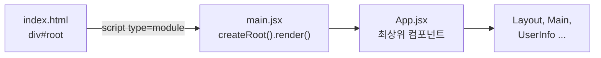
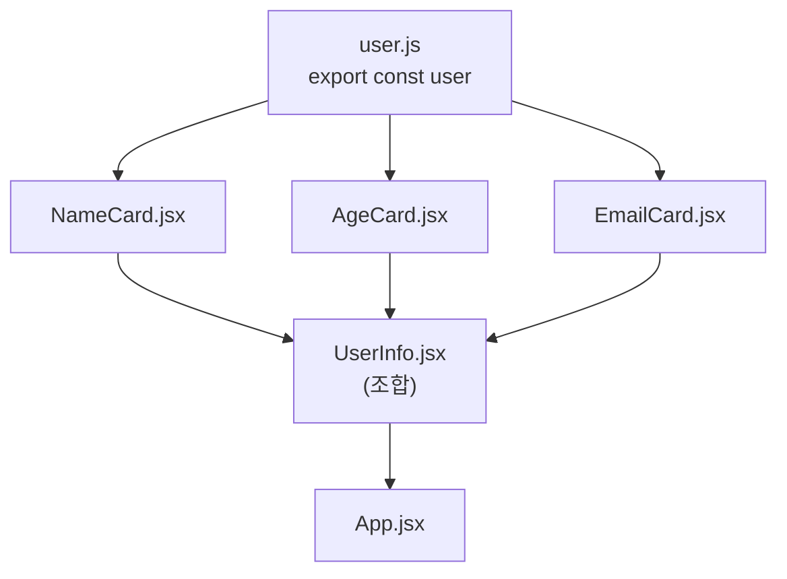

## 들어가며 (Situation)

[앞 글들]({{ site.baseurl }})에서는 HTML 파일 하나에 React와 Babel을 `<script>`로 불러와 실습했습니다. 이번에는 **Vite**로 실제 React 프로젝트(`component-app`)를 만들고, 컴포넌트와 데이터를 **파일 단위로 나눠 import/export** 했습니다.

> 실제 서비스에서 겪은 문제가 아니라, 수업 실습을 정리한 글입니다. 프로젝트는 React 19, Vite 8 버전으로 생성되었습니다. 설명은 Vite·React 공식 문서와 MDN을 기준으로 했고, 수업 코드 외에 직접 작성한 코드는 "예시 코드"로 표시했습니다. 예제의 개인 정보는 가상의 값으로 바꿨습니다.

## 문제 상황 (Task)

HTML 한 장 방식에는 한계가 있습니다.

- 페이지를 열 때마다 브라우저에서 Babel이 JSX를 변환하므로 느립니다.
- 컴포넌트가 늘어나면 파일 하나가 끝없이 길어집니다.
- 다른 라이브러리(라우터 등)를 쓰려면 `<script>`를 계속 추가해야 하고, 버전 관리도 어렵습니다.

Java로 치면 모든 클래스를 `Main.java` 하나에 몰아 쓰고, 라이브러리 jar를 손으로 내려받아 넣는 상황입니다. Spring에서는 Gradle과 패키지 구조로 해결했듯, React는 **빌드 도구**와 **모듈**로 해결합니다.

## 해결 과정 (Action)

### 1. Vite와 npm: 프론트엔드의 Gradle

**Vite**는 프론트엔드 **빌드 도구**입니다. 수업에서 만든 프로젝트의 `package.json`은 다음과 같습니다.

```json
{
  "name": "component-app",
  "private": true,
  "version": "0.0.0",
  "type": "module",
  "scripts": {
    "dev": "vite",
    "build": "vite build",
    "lint": "oxlint",
    "preview": "vite preview"
  },
  "dependencies": {
    "react": "^19.3.1",
    "react-dom": "^19.3.1",
    "react-router-dom": "^7.18.6"
  },
  "devDependencies": {
    "@vitejs/plugin-react": "^6.1.2",
    "oxlint": "^1.90.0",
    "vite": "^8.3.6"
  }
}
```

`package.json`은 [Spring Boot 프로젝트의 `build.gradle`]({{ site.baseurl }})과 같은 역할입니다.

| 하는 일 | Spring Boot (Gradle) | React (npm + Vite) |
|---------|---------------------|-------------------|
| 프로젝트 정보·의존성 | `build.gradle` | `package.json` |
| 실행에 필요한 의존성 | `implementation` | `dependencies` |
| 개발할 때만 필요한 의존성 | `testImplementation`, `developmentOnly` | `devDependencies` |
| 라이브러리 저장소 | Maven Central | npm 레지스트리 |
| 설치 위치 | `~/.gradle` 캐시 | 프로젝트 안 `node_modules/` |
| 정확한 버전 고정 | (lock 파일 선택) | `package-lock.json` |
| 개발 실행 | `bootRun` | `npm run dev` |
| 배포용 빌드 | `bootJar` → jar | `npm run build` → `dist/` |

```bash
npm install          # package.json 의 의존성을 node_modules 에 설치
npm run dev          # 개발 서버 실행 (http://localhost:5173)
npm run build        # 배포용 파일을 dist/ 에 생성
```

`"react": "^19.3.1"`의 `^`는 "19.x 범위에서 19.3.1 이상"을 허용한다는 뜻입니다. 실제로 설치된 정확한 버전은 `package-lock.json`에 기록되어, 다른 사람이 `npm install` 해도 같은 버전이 설치됩니다. `node_modules/`는 용량이 크고 `npm install`로 다시 만들 수 있어서 `.gitignore`로 Git에서 제외합니다.

**Vite가 해 주는 일**

| 기능 | 설명 |
|------|------|
| JSX 변환 | `.jsx` 파일을 미리 일반 JS로 변환 (`@vitejs/plugin-react`) |
| 개발 서버 | `localhost:5173`에서 실행, 파일을 저장하면 **새로고침 없이** 바뀐 부분만 반영 (HMR) |
| 모듈 연결 | `import`/`export`로 나눈 파일들을 브라우저가 읽을 수 있게 처리 |
| 빌드 | 배포용으로 파일을 합치고 압축해 `dist/`에 출력 |

```javascript
// vite.config.js
import react from '@vitejs/plugin-react'
import { defineConfig } from 'vite'

export default defineConfig({
  plugins: [react()],
})
```

React 플러그인 하나를 등록한 것이 설정의 전부입니다. 앞 글의 `<script type="text/babel">` 방식에서 브라우저가 매번 하던 변환을, 이제 Vite가 개발·빌드 과정에서 미리 처리합니다.

### 2. 프로젝트 구조와 시작 흐름

```text
component-app
├── index.html              ← 진입 HTML
├── package.json
├── vite.config.js
├── public/                 ← 그대로 제공되는 정적 파일 (favicon 등)
└── src/
    ├── main.jsx            ← React 시작점
    ├── App.jsx             ← 최상위 컴포넌트
    ├── components/         ← 여러 곳에서 쓰는 공통 조각 (Navbar)
    ├── layouts/            ← 페이지 공통 틀 (Layout)
    ├── pages/              ← 페이지 단위 컴포넌트 (Main)
    └── module/             ← 수업 실습 컴포넌트
        ├── 01_intro/01_intro.jsx
        └── 02_module/ (UserInfo, NameCard, AgeCard, EmailCard, user.js)
```

`components`, `layouts`, `pages`로 나눈 것은 React가 강제하는 규칙이 아니라 **역할별로 폴더를 나누는 관례**입니다. Spring 프로젝트를 `controller`, `service`, `repository` 패키지로 나눈 것과 같은 발상입니다.

화면이 시작되는 흐름은 다음과 같습니다.

```html
<!-- index.html -->
<div id="root"></div>
<script type="module" src="/src/main.jsx"></script>
```

```jsx
// src/main.jsx
import { createRoot } from 'react-dom/client'
import App from './App.jsx'

createRoot(document.getElementById('root')).render(
    <App />
)
```



HTML 한 장 실습에서 `<script>` 안에 직접 쓰던 `createRoot(...).render(...)`가 `main.jsx`로 옮겨졌고, 화면은 `App` 컴포넌트에서 시작합니다. `<script type="module">`은 이 파일이 `import`/`export`를 쓰는 **ES 모듈**이라는 표시입니다. `main.jsx`는 Java의 `main` 메서드가 있는 실행 클래스(`@SpringBootApplication`)에 해당하는 진입점입니다.

### 3. .jsx 확장자

```jsx
// src/module/01_intro/01_intro.jsx
/*
    .jsx 는 js xml 의 약자로서
    단순 js 파일이 아닌 jsx 문법을 사용해서
    컴포넌트들을 작성하는 파일임을 확실하게 나타낸다.
*/
function Hello() {
    return <h3>HelloWorld~~~~~~~</h3>
}

export default Hello;
```

JSX가 들어 있는 파일은 `.jsx` 확장자를 씁니다. 사람에게는 "컴포넌트 파일"이라는 표시가 되고, 도구에게는 JSX 변환 대상이라는 표시가 됩니다. JSX가 없는 순수 데이터나 함수 파일(`user.js`)은 `.js`로 둡니다.

### 4. 모듈: 파일 하나가 하나의 범위

[JavaScript 모듈](https://developer.mozilla.org/en-US/docs/Web/JavaScript/Guide/Modules)에서 **파일 하나는 독립된 범위**입니다. 파일 안에서 선언한 변수·함수는 기본적으로 그 파일 밖에서 보이지 않습니다. 밖에서 쓰게 하려면 **`export`**로 내보내고, 쓰는 쪽에서 **`import`**로 가져옵니다.

수업에서는 사용자 정보를 보여 주는 카드 세 개를 각각 파일로 나누고, 데이터는 별도 파일로 뺐습니다.

```javascript
// src/module/02_module/user.js — 데이터
export const user = {
    name : '홍길동',
    age : 20,
    email : "user@email.com"
};
```

```jsx
// src/module/02_module/NameCard.jsx
import { user } from "./user";

export default function NameCard() {
    return <h1 style={{color : 'red'}}>{user.name}</h1>
}
```

```jsx
// src/module/02_module/AgeCard.jsx
import { user } from "./user";

export default function AgeCard() {
    return <h2 style={{color : 'orange'}}>{user.age}</h2>
}
```

```jsx
// src/module/02_module/EmailCard.jsx
import { user } from "./user";

export default function EmailCard() {
    return <h3 style={{color : 'blue'}}>{user.email}</h3>
}
```

```jsx
// src/module/02_module/UserInfo.jsx — 세 카드를 묶는 상위 컴포넌트
import NameCard from "./NameCard";
import AgeCard from "./AgeCard";
import EmailCard from "./EmailCard";

function UserInfo() {
    return (
        <div style={{ width : 300, border : '1px solid black' }}>
            <NameCard/>
            <AgeCard/>
            <EmailCard/>
        </div>
    );
}

export default UserInfo;
```



[컴포넌트 조합 글]({{ site.baseurl }})에서 한 파일 안에 함께 있던 컴포넌트들이 이제 파일로 나뉘고, `import`로 연결됩니다.

### 5. export default와 named export

수업 주석의 정리입니다.

> export default는 `{}` 없이 이름으로 import를 받을 수 있지만, 파일 당 1개로 제한된다. export는 `{}`를 통해서 import 받을 수 있으며, 여러 개를 하나의 파일에서 내보낼 수 있다.

| 구분 | 내보내기 | 가져오기 | 파일당 | 가져올 때 이름 |
|------|---------|---------|-------|--------------|
| **default export** | `export default AgeCard;` 또는 `export default function AgeCard() {}` | `import AgeCard from './AgeCard'` | **1개** | 자유 (`import Age from ...`도 가능) |
| **named export** | `export const user = ...` | `import { user } from './user'` | **여러 개** | 내보낸 이름과 **같아야 함** |

```javascript
// 예시 코드 — named export 여러 개와 다양한 import
// constants.js
export const SHOP_NAME = '냠냠분식';
export const MAX_POINT = 50;
export function formatPrice(p) { return `${p.toLocaleString()}원`; }

// 사용하는 쪽
import { SHOP_NAME, formatPrice } from './constants';      // 필요한 것만
import { MAX_POINT as LIMIT } from './constants';            // 이름 바꿔서
import * as C from './constants';                           // 전부 객체로 (C.SHOP_NAME)
```

named import의 `{ }`는 [구조 분해 할당]({{ site.baseurl }})과 모양이 같고, 이름을 맞춰야 한다는 점도 같습니다(실제로는 별개의 문법입니다).

보통 **컴포넌트 파일은 대표 컴포넌트 하나를 default export**로, **여러 값을 공유하는 파일(`user.js`, 상수, 유틸 함수)은 named export**로 씁니다. 이번 실습도 그 관례를 따랐습니다.

### 6. Java의 import와 비교

| 비교 | Java | JavaScript 모듈 |
|------|------|----------------|
| 공개 여부 | `public` / `private` 접근 제어자 | `export` 한 것만 공개 |
| 가져오는 기준 | 패키지 경로 `com.wanted.project.Menu` | **파일 경로** `./user`, `../components/Navbar` |
| 단위 | 클래스 (파일당 public 클래스 1개) | 변수·함수·객체·컴포넌트 무엇이든 |
| "대표 하나" | 파일명 = public 클래스명 | `export default` |
| 별칭 | 불가 (전체 이름으로 구분) | `import { a as b }` |
| 같은 패키지/폴더 | import 없이 사용 | **같은 폴더여도 import 필요** |

경로는 현재 파일 기준 **상대 경로**입니다. `./`는 같은 폴더, `../`는 상위 폴더입니다. `.jsx`, `.js` 확장자는 Vite가 찾아 주므로 생략할 수 있습니다. 반면 `react`, `react-router-dom`처럼 `./` 없이 이름만 쓰면 `node_modules`에 설치된 **패키지**를 가져옵니다.

### 7. import 문제가 생기면

수업 주석은 "React에서는 import/export가 굉장히 중요하고, 오류가 나면 첫 번째로 import 구문을 확인하라"고 했습니다. 실제로 자주 만나는 오류는 다음과 같습니다.

| 상황 | 결과 |
|------|------|
| 경로 오타 (`./Usr`) | 개발 서버가 "파일을 찾을 수 없음" 오류 표시 |
| default로 내보낸 것을 `{ }`로 가져옴 | 가져온 값이 없어 컴포넌트가 정의되지 않았다는 오류 |
| named로 내보낸 것을 `{ }` 없이 가져옴 | default export가 없다는 오류 |
| 대소문자 불일치 (`./navbar` vs `Navbar.jsx`) | OS에 따라 되거나 안 됨 (Windows에서는 되고 배포 서버에서 실패하기도 함) |
| import 해 놓고 사용하지 않음 | **오류 아님** — 린터(oxlint)의 경고 |

마지막 줄은 짚어 둘 만합니다. 수업 주석에는 "import 했는데 사용하지 않으면 오류가 발생할 수 있다"고 되어 있지만, 사용하지 않는 import는 실행 오류가 아니라 린터의 경고입니다. 실제로 실행을 막는 것은 위의 경로·default/named 불일치입니다. 그래도 "오류가 나면 import부터 보라"는 조언은 유효합니다. React 초반 오류의 상당수가 import에서 나기 때문입니다.

## 결과 (Result)

정량 지표는 없고, 아래를 정리했습니다.

- Vite는 JSX 변환, 개발 서버(HMR), 모듈 연결, 빌드를 맡는 빌드 도구이고, `package.json`·`npm`은 Gradle처럼 의존성과 실행 명령을 관리합니다.
- 시작 흐름은 `index.html`(div#root) → `main.jsx`(createRoot) → `App.jsx`이며, 폴더는 역할별로 나누는 것이 관례입니다.
- JavaScript 모듈에서 파일은 독립된 범위이고, `export`한 것만 `import`할 수 있습니다.
- `export default`는 파일당 하나·이름 자유, named export는 여러 개·같은 이름으로 `{ }`에 넣어 가져옵니다. 컴포넌트는 default, 공유 값은 named로 쓰는 것이 일반적입니다.
- Java와 달리 패키지가 아니라 파일 경로로 가져오고, 같은 폴더여도 import가 필요합니다.
- 실행 오류는 주로 경로 오타와 default/named 불일치에서 나며, 사용하지 않는 import는 경고입니다.

## 더 학습하면 좋은 개념

- **ES Modules와 CommonJS** — `import`/`export`(ESM)와 Node.js의 옛 방식 `require`/`module.exports`(CommonJS)의 차이입니다.
- **번들링과 트리 쉐이킹** — 빌드할 때 여러 파일을 합치고, 사용하지 않는 코드를 빼는 과정입니다.
- **환경 변수(`import.meta.env`)** — API 주소처럼 개발·운영 환경마다 다른 값을 Vite에서 관리하는 방법입니다.
- **Vite 개발 서버 프록시** — 프론트(5173)에서 Spring 백엔드(8080) API를 호출할 때 CORS 문제를 피하는 설정입니다.
- **경로 별칭(alias)** — `../../components/Navbar` 대신 `@/components/Navbar`처럼 쓰는 설정입니다.

## 참고 자료

- [Vite - Getting Started](https://vite.dev/guide/)
- [Vite - Features](https://vite.dev/guide/features.html)
- [Vite - Building for Production](https://vite.dev/guide/build.html)
- [React - Creating a React App (Build Tools)](https://react.dev/learn/creating-a-react-app)
- [React - Importing and Exporting Components](https://react.dev/learn/importing-and-exporting-components)
- [MDN - JavaScript modules](https://developer.mozilla.org/en-US/docs/Web/JavaScript/Guide/Modules)
- [MDN - export](https://developer.mozilla.org/en-US/docs/Web/JavaScript/Reference/Statements/export)
- [MDN - import](https://developer.mozilla.org/en-US/docs/Web/JavaScript/Reference/Statements/import)
- [npm Docs - package.json](https://docs.npmjs.com/cli/configuring-npm/package-json)
